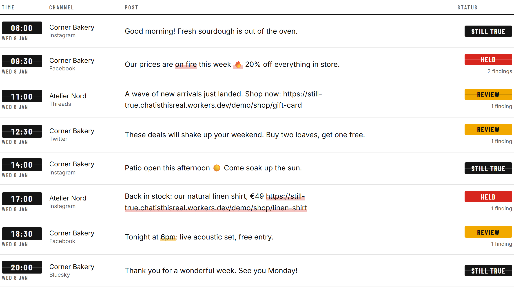
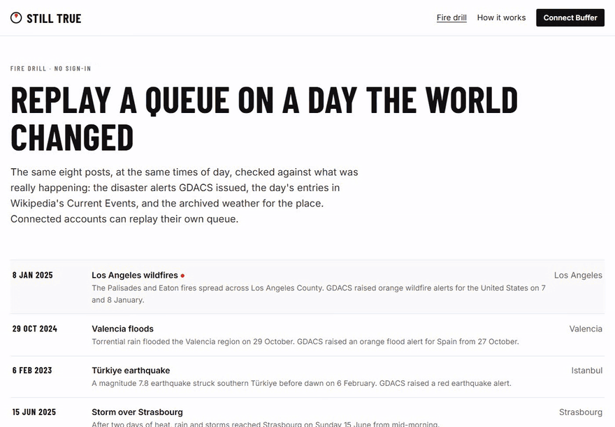
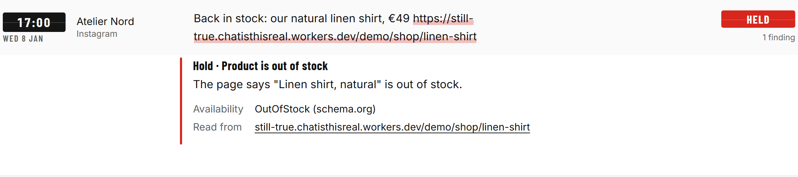
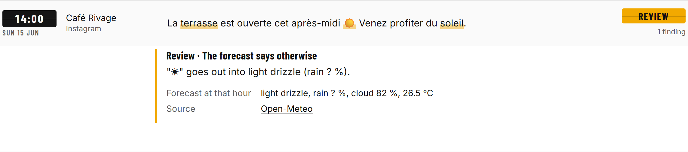
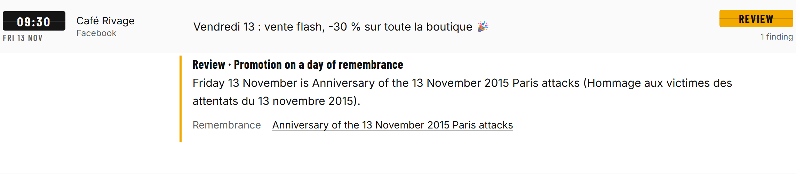

<p align="center"></p>

<h1 align="center">Still True</h1>

<p align="center">
  <a href="https://github.com/Marc-Dvci/Still-True/actions/workflows/tests.yml"></a>
  <a href="https://github.com/Marc-Dvci/Still-True/actions/workflows/live.yml"></a>
  <a href="https://github.com/Marc-Dvci/Still-True/actions/workflows/codeql.yml"></a>
  
  
  <a href="LICENSE"></a>
</p>

**Still True re-checks every scheduled Buffer post against the world just before it goes out, and holds the posts the world has made wrong.**

> In the IT audits I worked on, a control counted only if it still held on the day it mattered, not the day it was approved. Still True applies that to a queue. *Marc Donovici*

[Live app](https://still-true.chatisthisreal.workers.dev) · [Fire drill, no sign-in](https://still-true.chatisthisreal.workers.dev/drill) · [For judges](#for-judges) · [How it works](#how-it-works) · [Evidence](#evidence) · [Run it](#run-it)

| | |
|---|---|
| Live | [still-true.chatisthisreal.workers.dev](https://still-true.chatisthisreal.workers.dev), any Buffer account connects with OAuth |
| Built for | Buffer Commit 2026 |
| Built with | Buffer GraphQL API and OAuth 2.0 with PKCE · Cloudflare Workers, Durable Objects (SQLite), Workers AI · TypeScript |
| Headline | 410 labelled cases written before the code: every verdict matches the rules, no healthy post held or flagged. Five real days replayed with the alerts, news and weather recorded for them |

## For judges

| Criterion | Where to look |
|---|---|
| **Real usefulness** | The problem in [one paragraph](#the-problem); the five checks and the [fire drill](https://still-true.chatisthisreal.workers.dev/drill) on real days; holds that never delete and are explained inside Buffer ([`src/durable/org.ts`](src/durable/org.ts)) |
| **Execution and craft on the Buffer API** | [How it uses Buffer](#how-it-uses-buffer): 13 GraphQL operations, each [validated against Buffer's introspected schema](test/unit/operations.test.ts) in CI; PKCE with rotating refresh tokens owned by one Durable Object; [request budget](docs/BUFFER_API.md#request-budget); the [Worker tests](test/worker/org.test.ts) that hold, note, tag, release and fix through a recorded Buffer stand-in |
| **Creativity and originality** | A queue that reads the world before it speaks: weather, remembrance days, disaster alerts and the linked page, checked at the moment of publishing. The [fire drill](#the-fire-drill) replays your own queue on a real day the world changed |

## See it work

<p align="center"></p>

| A product page that changed | A forecast that changed | A day of remembrance |
|---|---|---|
|  |  |  |

## The problem

A scheduled post is a promise written on Monday about Friday. Writing ahead is Buffer's whole value, and it has one failure: the world moves in between. The shirt sold out. The concert was postponed. "Tomorrow" now means another day. It is raining on the "terrace open" post. A wildfire reached the audience's city an hour ago. Today the protection is a manual, all-or-nothing pause button, in Buffer and in every other scheduler, and it only helps someone who is watching. Small businesses are not watching at 08:55, and agents now fill queues days ahead.

Still True is for the café owner, the shop, the venue and the agency running client queues. It reads each post again 60 and 10 minutes before it goes out.

## How it works

<p align="center"></p>

**Rules decide every verdict; a model drafts wording only when a person asks.** Each finding names its evidence: what the post says, what the source says now, and when it was read.

| Check | Example | Source of truth | Verdict |
|---|---|---|---|
| Calendar | "Join us Friday 14 November" when 14 November 2026 is a Saturday; "demain, dimanche 15" read on Friday 13; "tonight at 6pm" going out at 18:30; a sale "until 1 December" going out on 3 December; "good morning" at 20:30 | The post's own words, read on the publish day in the channel's timezone | Review, or hold for a date already passed |
| Your own page | "Back in stock, €49" while the page says out of stock; a price the page no longer shows; an event cancelled, postponed or moved | schema.org JSON-LD (Shopify, WooCommerce, Wix, ticketing sites), Shopify's `.js` product endpoint, HTTP status | Hold, or review with the corrected price or date |
| Weather | "Terrace open this afternoon ☀️" into 90 % rain | Open-Meteo forecast for the due hour | Review, with the next dry, bright slot proposed |
| Remembrance | A flash sale in Paris on 13 November | 31 national days in 17 countries, each with its source ([`data/remembrance.json`](data/remembrance.json)) | Review |
| The world | "Our prices are on fire 🔥" the day a wildfire alert hits the audience's country | GDACS red and orange alerts; Wikipedia's Current Events | Hold for wording that echoes the hazard, review for promotions |

The full rule for each of the 18 codes is on the [How it works page](https://still-true.chatisthisreal.workers.dev/about). Supportive posts ("our thoughts are with", "collecting donations", "we will be closed") are never flagged by the disaster and news checks.

### What happens to a flagged post

1. **Held, never deleted.** A certain problem (sold out, cancelled, a date already passed, wording that echoes an active disaster) moves the post to drafts with `editPost(saveToDraft: true)`. Its original time is kept.
2. **Explained inside Buffer.** A note on the post (`createCollaborationNote`) and a tag, "Still True: held" or "Still True: review", say what changed and where it was read. The team sees it in Buffer without opening Still True.
3. **One tap to fix or release.** The corrected price, the right weekday or the next dry slot is applied with `editPost`. Release puts the post back at its original time. A setting turns holds off entirely: notes only.

### The fire drill

[`/drill`](https://still-true.chatisthisreal.workers.dev/drill) replays a queue on a real day the world changed, with the records published for that day: GDACS alerts, Wikipedia's Current Events and Open-Meteo's archived weather. Signed-in accounts replay their own queue at the same times of day.

| Day | Place | Held | Review | Still true |
|---|---|---|---|---|
| 8 Jan 2025, Palisades and Eaton fires | Los Angeles | 2 | 3 | 3 |
| 29 Oct 2024, floods | Valencia | 3 | 3 | 2 |
| 6 Feb 2023, earthquake | Istanbul | 2 | 4 | 2 |
| 15 Jun 2025, storm | Strasbourg | 1 | 3 | 4 |
| 13 Nov 2026, anniversary of the 2015 attacks | Paris | 1 | 3 | 4 |

### For agents

`POST /mcp` is an MCP server (Streamable HTTP) with one read-only tool, `check_post`. An agent that schedules through Buffer's own MCP server can ask Still True first.

```json
{"jsonrpc":"2.0","id":1,"method":"tools/call","params":{"name":"check_post","arguments":{"text":"Join us Friday 14 November!","due_at":"2026-11-12T18:00:00+01:00","timezone":"Europe/Paris"}}}
```

## How it uses Buffer

| Need | Buffer API | Code |
|---|---|---|
| Connect any Buffer account | OAuth 2.0 Authorization Code with PKCE (S256), `offline_access`; single-use refresh tokens refreshed by exactly one owner, the account's Durable Object | [`src/buffer/oauth.ts`](src/buffer/oauth.ts) |
| Read the queue | `posts` filtered by status (`scheduled`, timed `draft`) and a seven-day `dueAt` window, sorted by `dueAt` | [`src/buffer/operations.ts`](src/buffer/operations.ts) |
| Local day and hour | `channels`: `timezone`, `service`, `isDisconnected`; `account.timezone` for the default country | [`src/durable/org.ts`](src/durable/org.ts) |
| Hold, release, fix | `editPost` with `saveToDraft`, `mode: customScheduled` + `dueAt`, `text`, `tagIds` | [`src/durable/org.ts`](src/durable/org.ts) |
| Explain inside Buffer | `createCollaborationNote`, `tagsV2`, `createTag` | [`src/durable/org.ts`](src/durable/org.ts) |
| Sample drafts | `createPost` with `saveToDraft: true` | [`src/demo/samples.ts`](src/demo/samples.ts) |

Every operation is validated against [`schema/buffer.graphql`](schema/buffer.graphql), the schema introspected from `api.buffer.com`, in CI. Typed mutation errors (`... on MutationError`), 401s, `RATE_LIMIT_EXCEEDED` with `Retry-After`, and the `RateLimit` headers are all handled. Details and the request budget: [`docs/BUFFER_API.md`](docs/BUFFER_API.md).

## What it will not do

- It never deletes a post and never publishes one. A hold is a move to drafts.
- No model decides anything. Workers AI is called only when a person presses "Suggest wording", and a suggestion is refused if it adds a number, date, link, handle or hashtag the post did not contain ([`src/ai/assist.ts`](src/ai/assist.ts)).
- It stores only what a check needs, for posts in the next seven days, and deletes everything on disconnect ([privacy](https://still-true.chatisthisreal.workers.dev/privacy), [system card](docs/SYSTEM_CARD.md)).

## Evidence

| Measure | Result | Reproduce |
|---|---|---|
| Labelled cases, written and committed before the detectors | 267 development cases, 143 held-out cases (191 healthy in total): every verdict and every finding code matches the written rules; 0 healthy posts held or flagged | `npm run eval` and `npm run eval -- heldout` · [`docs/EVALUATION.md`](docs/EVALUATION.md) |
| Real markup | Prices, stock and event status read correctly from Shopify, WooCommerce, Wix and ticketing-site markup, including a malformed JSON-LD block and an event postponed only in its title | [`test/unit/page.test.ts`](test/unit/page.test.ts) |
| Real days | The five drills above, on the recorded GDACS, Wikipedia and Open-Meteo data | [`test/unit/drill.test.ts`](test/unit/drill.test.ts) |
| Buffer contract | 13 operations valid against the introspected schema | [`test/unit/operations.test.ts`](test/unit/operations.test.ts) |
| Tests | 165 unit · 41 Worker and Durable Object tests in workerd · 12 browser tests with axe-core (WCAG 2.2 AA, desktop and mobile). Decision core coverage: 99.4 % of lines, 85.0 % of branches | `npm test`, `npm run test:unit`, `npm run test:e2e` |

> [!IMPORTANT]
> What is real: the disaster alerts, news items and weather in the fire drill are the records GDACS, Wikipedia and Open-Meteo published for those days, and the page fixtures reproduce the markup of real Shopify, WooCommerce, Wix and ticketing pages. Atelier Nord and Salle Rivage are the demo shop and venue Still True serves itself, so the sample drafts have pages to link to.

### Claims and the tests that hold them

| Claim | Test |
|---|---|
| A certain problem moves the post to drafts, adds a note and the held tag, and leaves healthy posts untouched | [`test/worker/org.test.ts`](test/worker/org.test.ts) "holds an out-of-stock post, explains it in Buffer, and leaves a healthy post alone" |
| A post is held and noted once, not on every check | [`test/worker/org.test.ts`](test/worker/org.test.ts) "does not hold again a post it already explained" |
| Notes-only mode never changes a post | [`test/worker/org.test.ts`](test/worker/org.test.ts) "only writes notes in 'notes' mode, and never holds" |
| Release restores the original time and removes the held tag | [`test/worker/org.test.ts`](test/worker/org.test.ts) "releases a held post at its original time and drops the held tag" |
| An expired token is refreshed once and Buffer's replacement kept | [`test/worker/org.test.ts`](test/worker/org.test.ts) "refreshes an expired token once and keeps Buffer's replacement" |
| The action log is hash-chained and detects an edited entry | [`test/worker/org.test.ts`](test/worker/org.test.ts) "chains the action log by hash and detects an edited entry" |
| Disconnect revokes the token and deletes everything | [`test/worker/org.test.ts`](test/worker/org.test.ts) "revokes the token and deletes everything on disconnect" |
| Tokens are bound to their account by AES-GCM associated data | [`test/worker/primitives.test.ts`](test/worker/primitives.test.ts) "round-trips, and fails for another owner or a tampered value" |
| PKCE matches RFC 7636 | [`test/worker/primitives.test.ts`](test/worker/primitives.test.ts) "computes the PKCE challenge of RFC 7636's test vector" |
| Supportive posts are never flagged during a disaster | [`test/unit/world.test.ts`](test/unit/world.test.ts) "never flags supportive posts" |
| A suggestion that adds a claim is refused | [`test/unit/assist.test.ts`](test/unit/assist.test.ts) "refuses a suggestion that adds a claim" |
| Dates and weekdays inside links are never read as words | [`test/unit/calendar.test.ts`](test/unit/calendar.test.ts) "ignores weekdays and dates inside URLs" |

## Run it

> [!TIP]
> No install, no key: open the [fire drill](https://still-true.chatisthisreal.workers.dev/drill). With Docker: `docker compose up`, then http://127.0.0.1:8788.

[](https://codespaces.new/Marc-Dvci/Still-True?quickstart=1)

Node 22 or later.

```sh
npm ci
npm test                      # unit tests and Worker tests in workerd, random order
npm run eval                  # the labelled cases
npm run test:e2e              # browser tests with axe-core
node scripts/dev_secrets.mjs && npx vite build && npx wrangler dev --env e2e --port 8788
```

To connect a real Buffer account locally, create an App Client in Buffer (Settings, API, App Clients) with the redirect URI `https://localhost:8787/auth/callback`, copy [`.dev.vars.example`](.dev.vars.example) to `.dev.vars`, fill it in, and run `npm run dev`.

## Layout

```
src/core/        the decision core: pure functions, no network, no clock
src/buffer/      GraphQL operations, API client, OAuth with PKCE
src/durable/     OrgDO (one per account) and WorldDO (shared)
src/fetchers/    linked pages and Open-Meteo, guarded and cached
src/demo/        the fire drill, the demo shop, the sample drafts
src/mcp.ts       the MCP endpoint
web/             the departure board (Vite, vanilla TypeScript)
data/            remembrance days, drill scenarios, place and timezone tables
eval/            labelled cases and the scorer
schema/          Buffer's introspected GraphQL schema
```

## Licence

MIT. Data sources and their licences are listed on the [How it works page](https://still-true.chatisthisreal.workers.dev/about#sources): GDACS, Wikipedia (CC BY-SA 4.0), Open-Meteo (CC BY 4.0). Still True is built on the Buffer API and is not an official Buffer product.
